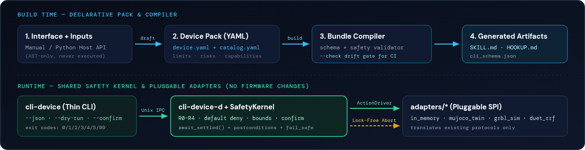

<p align="center">
  
</p>

<h1 align="center">CLI-Any-Device</h1>
<p align="center"><strong>Let AI drive all your devices</strong></p>

<p align="center">
  Turn any hardware with an accessible interface (serial, Ethernet HTTP, TCP/SCPI, or a Python host API) plus its manual or host software into a declarative device pack, a safety-gated AI CLI (<code>cli-device</code> + <code>cli-device-d</code>), a short agent <code>SKILL.md</code>, and a human <code>HOOKUP.md</code>.
</p>

<p align="center">
  
  
  
  
</p>

---

## Live Terminal Demo (Real Offline Session)

Recorded directly from `.venv/bin/cli-device` + `.venv/bin/cli-device-d` against the built-in `in_memory` target (`--help`, `sys detect`, `--dry-run`, `--confirm` gating, and `--dry-run sys abort`; raw transcript in [`docs/assets/demo-transcript.json`](docs/assets/demo-transcript.json)):

<p align="center">
  
</p>

## Why It Exists

Hardware interfaces are fragmented and dangerous for AI agents: letting an agent read raw firmware manuals or emit raw G-code/SCPI wastes context and invites unsafe actuation. **CLI-Any-Device** compiles device specifications into a small declarative pack and executes every command through one shared, device-agnostic safety kernel—without modifying vendor firmware.

## Honest Status & Scope

> **Current status:** Software, offline `in_memory` fake, and local simulation paths (`mujoco_twin`, `grbl_sim`, and loopback HTTP fixtures for `duet_rrf`) are implemented and tested. **End-to-end validation on physical hardware has not been completed yet**—do not treat this repository as field-certified for unattended actuation on real machines.

- **Fixtures vs. product:** `bundles/jubilee/` is the first complex verification fixture, not a Jubilee-only product.
- **Synthetic offline fixtures:** `tests/fixtures/` (`grbl_engraver`, `scpi_psu`, `open_radio`) are **synthetic offline test fixtures** used to verify generic onboarding. `OpenRadio-100` is **not** a real purchasable radio, and this project does not encourage RF transmission without proper authorization and a matched load/antenna.

## How It Works

<p align="center">
  
</p>

1. **Draft a device pack:** `cli-device bundle draft` inspects a manual and/or Python host API (via safe AST parsing—vendor code is never executed) to emit `device.yaml` + `catalog.yaml`.
2. **Compile artifacts:** `cli-device bundle build` validates schemas/limits and compiles `SKILL.md`, `HOOKUP.md`, and `cli_schema.json` (`--check` fails CI on drift).
3. **Run through the safety kernel:** thin `cli-device` sends JSON over local Unix IPC to `cli-device-d`, which enforces R0–R4 gates, bounds, `--dry-run`, `--confirm`, completion barriers, and lock-free abort before calling pluggable `adapters/*`.
4. **No firmware changes:** adapters implement `SupervisorChannel` + `ActionDriver` (`adapter_spi/`) and only translate existing device interfaces.

## Install

Requires Python 3.11+.

```bash
uv venv --python 3.13 .venv
uv pip install --python .venv/bin/python -e ".[dev]"
```

## Quickstart (Verified Offline)

### 1. Run `cli-device-d` + `cli-device` against the built-in `in_memory` target

```bash
# Terminal 1: start the safety daemon (stop cleanly with Ctrl-C or SIGTERM)
.venv/bin/cli-device-d --bundle jubilee --socket /tmp/cli-device-demo.sock

# Terminal 2: inspect commands, detect, dry-run, confirm, and check status
.venv/bin/cli-device --bundle jubilee --help
.venv/bin/cli-device --bundle jubilee --target in_memory --socket /tmp/cli-device-demo.sock --json sys detect
.venv/bin/cli-device --bundle jubilee --target in_memory --socket /tmp/cli-device-demo.sock --json sys preflight
.venv/bin/cli-device --bundle jubilee --target in_memory --socket /tmp/cli-device-demo.sock --json --dry-run motion home-all
.venv/bin/cli-device --bundle jubilee --target in_memory --socket /tmp/cli-device-demo.sock --json --confirm motion home-all
.venv/bin/cli-device --bundle jubilee --target in_memory --socket /tmp/cli-device-demo.sock sys status
```

### 2. Draft & compile a new device pack from a manual + Python host API

```bash
.venv/bin/cli-device bundle draft \
  --name bench_psu \
  --display-name "Synthetic SCPI PSU Fixture" \
  --kind instrument \
  --interface tcp_scpi \
  --endpoint tcp://192.168.10.50:5025 \
  --manual tests/fixtures/scpi_psu/manual.md \
  --host-api tests/fixtures/scpi_psu/psu_host.py \
  --output /tmp/bench_psu_bundle

.venv/bin/cli-device bundle validate /tmp/bench_psu_bundle
.venv/bin/cli-device bundle build /tmp/bench_psu_bundle --output-dir /tmp/bench_psu_gen
.venv/bin/cli-device bundle build /tmp/bench_psu_bundle --output-dir /tmp/bench_psu_gen --check
.venv/bin/cli-device --bundle /tmp/bench_psu_bundle --help
```

## Safety Boundaries

| Mechanism | Behavior |
|---|---|
| **R0–R4 & Default Deny** | Unknown state, unhomed motion, out-of-bounds parameters, forbidden zones, and unsafe Z are rejected before `ActionDriver.execute()` (exit `3`). |
| **`--dry-run` & `--confirm`** | `--dry-run` checks gates and prints a plan with zero actuation (including `--dry-run sys abort`); high-risk actions require `--confirm` (exit `4`). |
| **Completion Barrier** | Command acceptance (e.g. HTTP 200 on Duet `/rr_gcode`) is never treated as completion; live adapters wait in `SupervisorChannel.await_settled()` (`M400` + object model `idle` on Duet/RRF), verify postconditions, and apply catalog `fail_safe` on failure. |
| **Lock-Free Abort vs. Physical E-Stop** | `sys abort` bypasses the action mutex (`< 100 ms` target) and latches e-stop (exit `99`). **Software abort never disconnects mains/motor power and never replaces a tested physical emergency stop.** |
| **Honest Capabilities** | Capability-limited targets (e.g. `grbl_sim`, which is not a real Jubilee) reject unsupported verbs with `E_UNSUPPORTED_CAPABILITY` (exit `2`) instead of faking success. |

**Exit codes:** `0` OK / dry-run verified · `1` execution fault (fail-safe applied) · `2` usage / schema / unsupported capability · `3` safety denied · `4` `--confirm` required · `5` timeout / daemon unavailable · `99` e-stop latched

## Repository Layout

| Path | Role |
|---|---|
| `core_types/` | Pure domain types, risk classes, error/exit codes (zero I/O) |
| `adapter_spi/` | `SupervisorChannel` & `ActionDriver` protocols + `InMemoryFakeAdapter` |
| `compiler/` | Bundle loader/validator, AST+manual drafter, `SKILL.md`/`HOOKUP.md`/`cli_schema.json` compiler |
| `safety_kernel/` | Device-agnostic R0–R4 gate, preconditions, completion & fail-safe |
| `daemon/` | `cli-device-d` Unix socket IPC server and lazy `cli_any_device.adapters` registry |
| `cli/` | Thin schema-driven `cli-device` frontend and `bundle` toolchain |
| `bundles/jubilee/` | Hand-authored Jubilee verification fixture (`docs/generated/jubilee/` is compiled output) |
| `adapters/` | Pluggable adapters (`duet_rrf`, `mujoco_twin`, `grbl_sim`), isolated from core |
| `docs/assets/` | Hero banner, architecture diagram, and reproducible terminal demo GIF sources |

## Verification

```bash
.venv/bin/pytest -v
.venv/bin/mypy
.venv/bin/ruff check core_types adapter_spi compiler safety_kernel daemon cli tests/test_import_dag.py tests/test_contracts_and_spi.py tests/test_compiler.py tests/test_safety_kernel.py tests/test_daemon_and_cli.py tests/test_framework_fixes_and_fixtures.py
.venv/bin/cli-device bundle build jubilee --check
```
