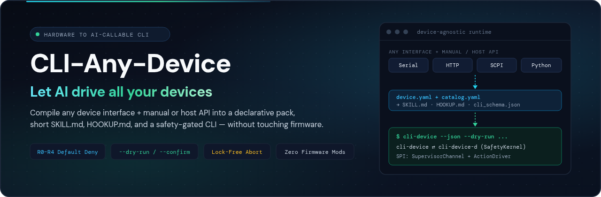
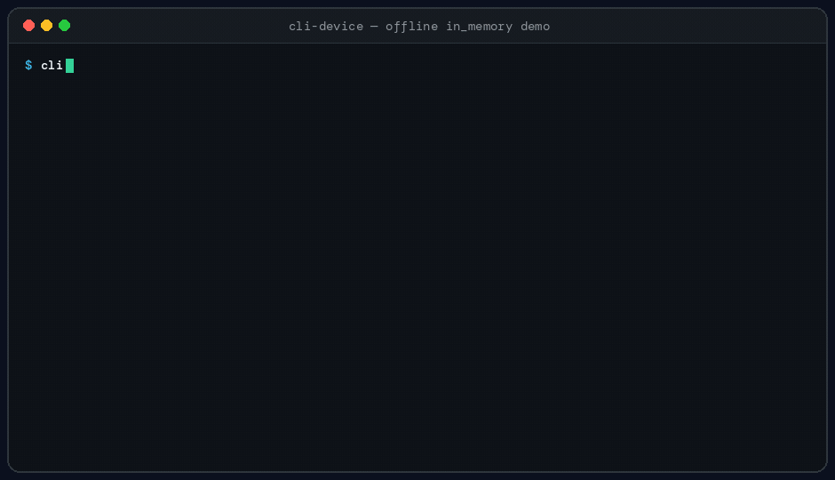

<p align="center">
  
</p>

<h1 align="center">CLI-Any-Device</h1>
<p align="center"><strong>Let AI drive all your devices</strong></p>

<p align="center">
  <a href="https://github.com/xmtom111/cli-any-device/actions/workflows/ci.yml"></a>
  <a href="LICENSE"></a>
  
</p>

Turn a device manual or Python host API into a YAML bundle, a safety-gated CLI, an agent skill, and a hookup guide. The daemon checks capabilities, limits, and approvals before dispatching actions through an adapter.

**Status.** Offline, simulation, and loopback test paths are verified. End-to-end validation on physical hardware has yet to be completed. The devices under `tests/fixtures/` are synthetic offline fixtures.

<p align="center">
  
</p>

## Install

Requires Python 3.11+. Choose either tool installer.

```bash
uv tool install 'git+https://github.com/xmtom111/cli-any-device.git'
pipx install 'git+https://github.com/xmtom111/cli-any-device.git'
```

To install a local wheel, build it with `uv build --wheel` in the checkout and pass the wheel path to `uv tool install` or `pipx install`.

For development, run from the repository root.

```bash
uv venv .venv
source .venv/bin/activate
uv pip install -e '.[dev]'
```

## Quickstart

From a checkout, use the Jubilee bundle with its offline `in_memory` target.

```bash
cli-device use ./bundles/jubilee --target in_memory
cli-device up
cli-device sys detect
cli-device --dry-run motion home-all
cli-device --confirm motion home-all
cli-device sys status
cli-device down
```

`cli-device use` saves the bundle and target. With saved defaults, a command auto-starts the daemon when needed. Use `cli-device up` and `cli-device down` to manage it explicitly, or `--no-auto-start` to suppress auto-start for a command.

The managed daemon defaults to authenticated loopback TCP on an automatically assigned port. To choose a port, pass `--listen tcp://127.0.0.1:<port>` to `cli-device up` or `cli-device-d`. The CLI reuses the managed daemon's bearer token. For a manually started daemon, supply the same token to both sides via `--token-file` or `CLI_DEVICE_IPC_TOKEN`. Unix sockets are also supported.

### Human approval

Start the daemon with `--confirm-mode=tty` (the default) or `--confirm-mode=token`. For a one-off action, a human can use `--confirm` in an interactive terminal. For an agent workflow, preview the action with `--dry-run`, have a human run `cli-device approve <plan_id>` in an interactive terminal, then repeat the same action with `--plan-id <plan_id>`. Plans are single-use and bound to the target, arguments, and machine state.

For repeated actions, a human can use `cli-device lease grant` with a target, a TTL in seconds, a maximum risk, and optional `--allow-service` restrictions. Use `cli-device lease status` and `cli-device lease revoke` to inspect or end the lease.

### Live hardware

Unlocking mutations on a real target requires both `review_status: verified` in `device.yaml` and `cli-device-d --allow-live-hardware` (also available via `cli-device up --allow-live-hardware`). Approval, capability, and safety checks still apply.

## Device bundles and adapters

`cli-device bundle draft` reads manuals and parses Python host APIs without executing vendor code. Review the resulting `device.yaml` and `catalog.yaml`, then run `cli-device bundle build <bundle>` to validate them and generate `SKILL.md`, `HOOKUP.md`, and `cli_schema.json`.

The config-driven `scpi_generic`, `http_json`, and `moonraker_http` adapters use YAML for supported devices, with zero per-device Python. Choose an adapter and set target-level `adapter_options` in `device.yaml`. Define each service's protocol mapping in the catalog's `protocol` block. The synthetic SCPI supply shows both files. See the [SCPI fixture bundle](tests/fixtures/scpi_psu/bundle/) and [all six adapters](adapters/README.md).

<p align="center">
  
</p>

The daemon runs each action through the shared safety kernel. The kernel validates state and bounds, waits for the adapter's completion barrier, and checks postconditions. Software abort bypasses the action lock. Physical emergency stops are handled at the machine.

## Agent integration

- `cli-device skill install <bundle>` installs the bundle's skill. `cli-device skill install --meta` installs the device onboarding skill. Both default to writing `SKILL.md` under `.claude/skills/` and `.agents/skills/` in the current project.
- `cli-device mcp serve` runs a pure-stdlib stdio MCP server using the selected bundle and target. It exposes catalog services through the daemon and excludes `R4_EXPERT` and the `expert` group. Tools support dry runs and approved plan IDs.

## Repository layout

| Path | Role |
| --- | --- |
| `core_types/`, `adapter_spi/` | Shared contracts and the in-memory adapter |
| `compiler/` | Bundle drafting, validation, and artifact generation |
| `safety_kernel/` | Risk gates, approval checks, completion, and fail-safe policies |
| `daemon/`, `cli/` | IPC, adapter discovery, and user and agent commands |
| `adapters/` | Six built-in protocol and simulation plugins |
| `bundles/jubilee/`, `docs/generated/jubilee/` | Jubilee example bundle and its generated files |
| `skills/` | Agent onboarding skill |
| `tests/` | Runtime, adapter, and architecture tests plus synthetic fixtures |
| `docs/assets/` | Banner, architecture diagram, and recorded offline demo |

## Verification

Run from the checkout with the development environment active.

```bash
pytest -v
mypy
ruff check
cli-device bundle build jubilee --check
```

External simulator tests require a local checkout configured via `CLI_ANY_DEVICE_AUTODNA_ROOT`. See the [adapter constraints](docs/adapter-constraints.md) for simulator dependencies.
