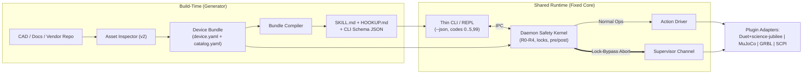

# Vertex consult 04 — General device-profile → generated CLI architecture

- Date: 2026-11-21 10:19 +08
- Model: gemini-4-carbon (default)
- Tools: default (google_search, url_context)

## Prompt

```
Prior conclusions (tight):
- Feasible with host daemon + thin CLI; no firmware fork; real Jubilee uses official Duet Ethernet HTTP; wrap science-jubilee verbs plus a direct-RRF supervisor (M400 + object-model completion; lock-bypassing M112).
- Catalog is YAML of atomic services (name, args, preconditions, effects, fail_safe, timeout, risk_class R0–R4). Agent-default verbs: sys.detect/status/preflight/abort, deck.*, motion.home_*/move_safe/move_to/move_rel/move_well, tool.pickup/park. Expert escape: expert.gcode, raw lock/unlock. SKILL.md is ~20-line catalogue + rules. Default-deny unhomed motion and unsafe Z; --confirm for home_all/home_z and post-estop reset. CLI --json; completion = M400 + model idle + postconditions, not HTTP 200. Exit codes 0/1/2/3/4/5/99.

Question: Architecture for a GENERAL pipeline: "device profile → generated safe CLI", not just one hardcoded Jubilee script pile.

User intent: inspect hardware/software design (CAD, schematics, docs, host software). If an open control interface exists, use it; if not, choose an easy physical hookup and write human instructions. Generate a compact atomic catalog and CLI (--help/--json/REPL/SKILL.md/manual) without scrambling vendor code. Must later apply to all open-source hardware; first implementation target is Jubilee. Local reusable assets: Jubilee STEP CAD (machineagency/jubilee v2.2.2), MuJoCo twin, GRBL emulator (sim only), AutoDNA atomic HTTP host vs traditional G-code host. CLI-Anything inspiration is the generation+distribution pipeline, not its undo model.

Please propose a clean layered architecture:
1. Layers and module boundaries (device profile, interface adapters, catalog compiler, safety kernel, CLI/JSON front-end, manual/hookup generator, optional digital twin). Mermaid is welcome.
2. Device-profile file format (what must be declared vs discovered at detect-time).
3. Adapter plugin model (Duet HTTP, USB serial, later SCPI/Moonraker/MCP-bridge, etc.) so adding a board does not fork the core.
4. Where generation happens vs what stays a shared runtime (safety, daemon, JSON contract). What v1 should hand-author for Jubilee vs what the later generator automates.
5. Simulator-first vs real-hardware later: how the same CLI talks to the existing local twin/sim without pretending GRBL is a real Jubilee.
6. Quality bar: how to keep module boundaries clean (no tangled scripts).

Design recommendations. Keep under ~900 words.
```

## Reply

### 1. Layered Architecture & Module Boundaries

The key architectural rule: **compile declarative specs, never generate runtime safety code.** A build-time pipeline inspects hardware/software assets to emit a validated **Device Bundle**, which a single, shared **Safe Runtime** executes.



* **Device Bundle:** Static YAML declaring kinematics, safety invariants, atomic verbs, and physical hookup specs.
* **Bundle Compiler:** Validates schemas and renders `SKILL.md` (~20 lines), `HOOKUP.md`, and the CLI command tree.
* **CLI / REPL Front-End:** Stateless, schema-driven binary. Parses args, enforces `--confirm` prompts (or tokens in `--json` mode), formats envelopes, and maps outcomes to exit codes `0/1/2/3/4/5/99`.
* **Daemon Safety Kernel:** Owns the execution mutex, tracks state, evaluates R0–R4 policies/preconditions, verifies postconditions, and holds a **dedicated, lock-bypassing abort lane**.
* **Interface Adapters:** Translate canonical verbs and state polls into board/sim protocols while keeping vendor libraries isolated.

---

### 2. Device-Profile Format: Declared vs. Discovered

Split the bundle into `device.yaml` (physics, topology, transports) and `catalog.yaml` (atomic R0–R4 verbs).

* **Declared (Static in YAML):**
  * *Geometry & Limits:* Axis names/bounds (extracted from Jubilee v2.2.2 STEP / RRF `config.g`), safe-Z plane, keep-out zones, tool-rack coordinates, deck slot transforms.
  * *Hookup Spec:* Preferred open interface (e.g., Duet Ethernet HTTP) or fallback physical bridge (e.g., USB-UART / relay tap + wiring pinout for `HOOKUP.md`).
  * *Targets & Capabilities:* Named targets (`duet_real`, `mujoco_twin`, `grbl_sim`) with explicit capability tags (`axes_xyz`, `tool_lock_u`, `rrf_object_model`).
  * *Service Catalog:* `name`, typed `args`, `requires_capabilities`, `preconditions` (e.g., `axes.homed == true and pos.z >= safe_z`), `effects`, `postconditions`, `fail_safe`, `timeout`, `risk_class` (`R0`–`R4`).
* **Discovered (`sys.detect` & Live Polling):**
  * Reachable endpoint/port, board/firmware identity, homed flags per axis, live coordinates, active tool/lock sensor state, spindle/heater idle status, estop latch state, and currently mounted labware/deck state.

---

### 3. Adapter Plugin Model

Adding Moonraker, SCPI, AutoDNA HTTP, or USB-serial must never fork the daemon. Every adapter registers via Python `entry_points` and implements **two separate Protocols**:

1. **`SupervisorChannel` (Mandatory, State & Safety):**
   * `detect() -> Identity`
   * `poll_state() -> CanonicalMachineState` (normalized homed flags, coordinates, queue/model status, faults).
   * `await_settled(timeout)` (for Jubilee: `M400` + RRF object-model `state.status == "idle"`).
   * `abort_now()` — **stateless, lock-free out-of-band path** (e.g., separate socket firing Duet `M112`, serial DTR drop, or power-relay cut) that never waits on the `ActionDriver` mutex.
2. **`ActionDriver` (Pluggable Verb Execution):**
   * Wraps clean vendor Python (`science-jubilee`, AutoDNA client) *or* dispatches raw protocol frames (G-code, SCPI) without importing vendor internals into the core.
   * Returns raw telemetry; **the Safety Kernel—not the adapter—decides completion** by calling `SupervisorChannel.await_settled()` + checking catalog `postconditions`.

---

### 4. Generated vs. Shared Runtime (v1 vs. Later)

* **Shared Runtime (Never Generated):** Daemon IPC, mutex + lock-bypass abort router, expression evaluator for preconditions/postconditions, R0–R4/`--confirm` gatekeeper, JSON envelope serializer, exit-code mapper, and schema-driven CLI engine (built on Click/Typer reading `catalog.yaml` at startup—zero generated Python boilerplate to rot).
* **Generated Artifacts:** `device.yaml`, `catalog.yaml`, `SKILL.md`, `HOOKUP.md` (human wiring/IP setup guide), and JSON Schemas.
* **v1 (Jubilee) vs. v2 (General OSHW):**
  * *v1 Hand-Authored:* Jubilee `device.yaml` + `catalog.yaml`, the `duet_rrf` adapter (wrapping `science-jubilee` + direct RRF HTTP supervisor), and `mujoco_twin` / `grbl_sim` adapters. Build the **Bundle Compiler** now so `SKILL.md`, `HOOKUP.md`, and CLI help/REPL are already 100% compiled from YAML.
  * *v2 Automated:* Build the **Asset Inspector** that ingests STEP CAD (mate limits/envelope), schematics/firmware configs (pins, baud, HTTP endpoints), and vendor host repos to auto-draft `device.yaml`, `catalog.yaml`, and fallback physical hookup instructions for human sign-off.

---

### 5. Simulator-First vs. Real Hardware

Select backends explicitly via `--target mujoco_twin | grbl_sim | duet_real` (or env var), governed by **capability matching**:

* **`mujoco_twin` (High-Fidelity Digital Twin):** Advertises `axes_xyz`, `tool_lock_u`, and collision sensing, seeded from Jubilee v2.2.2 STEP geometry. Runs the **entire** Jubilee catalog (`motion.*`, `tool.pickup/park`, `deck.*`). `await_settled()` waits for trajectory completion + zero contact/collision violations.
* **`grbl_sim` (Motion-Only Smoke Test):** Advertises `axes_xyz` and `serial_gcode` only—no `tool_lock_u` or RRF object model. `sys.status` and `motion.move_*` work identically; calling `tool.pickup` fails cleanly at the Safety Kernel preflight with **exit code `2`** (`CAPABILITY_UNSUPPORTED: tool_lock_u`), never faking tool state or pretending GRBL is Duet RRF.

---

### 6. Quality Bar: Keeping Module Boundaries Clean

1. **Enforced Import DAG (`import-linter` in CI):** `cli -> ipc_schema <- kernel -> adapter_api <- plugins/*`. Core packages are forbidden from importing `science_jubilee`, `mujoco`, `serial`, or `requests`.
2. **Vendor Quarantine:** Vendor repos sit untouched as git submodules or pinned wheels inside `plugins/<vendor>/`; adapters translate only plain Pydantic/dataclass DTOs.
3. **Protocol Conformance Suite:** Every adapter plugin must pass a shared contract test (`poll_state` schema, `await_settled` blocking semantics, `abort_now` latency <100 ms while `ActionDriver` is artificially deadlocked).
4. **No String Smuggling:** Raw G-code/SCPI exists only inside adapters and the explicitly gated `R4` `expert.raw` verb.

## Meta

Tools were enabled; this call produced no stderr meta (no search-query dump).
