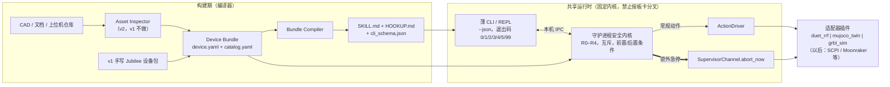

# CLI-Any-Device：把开源硬件变成可安全调用的 AI CLI

**技术路线与要求（v1 以 Jubilee 为试点）**

| 项 | 内容 |
|---|---|
| 文档日期 | 2026-11-21（Asia/Singapore，UTC+8） |
| 状态 | 方案稿。**待你批准后才允许 Antigravity / Codex 开工**；本文不包含实现代码。 |
| 建议项目名 | CLI-Any-Device |
| 建议命令 / 守护进程 | `cli-device` / `cli-device-d` |
| 建议实现语言 | Python 3.11+（`mypy` + `ruff` 强制），以便复用 `science-jubilee` 与本机已有仿真 |

文中凡称「已核实」的，均来自官方文档、本机只读材料，或本轮 Vertex 咨询中可回溯的公开接口；凡称「设计建议」的，是推荐默认，实施前可以改，但不能在未标明的情况下当成已验证事实。

---

## 1. 结论

**有条件可行（yes-with-limits）。** 只要目标机器已经暴露可查询的机器状态、真正的「动作完成」屏障，以及一条不排队的急停通道，就可以在**不分叉、不重写厂商固件**的前提下，用「设备画像 + 接口适配 + 原子服务目录 + 安全内核 + 薄 CLI」把开源硬件封装成 AI 可调用的命令行；但这不能替代物理急停，也不能覆盖需要十毫秒级闭环的控制。

更具体地说：

- **对 Jubilee 这类监督式运动平台，这条路是通的。** 官方控制面已经是 Duet / RepRapFirmware 的以太网 HTTP 与 G-code，实验室上位机 `science-jubilee` 已经把回原点、安全 Z、取放工具、载架与孔位等封装成 Python API。v1 应站在这些已有接口之上做原子 CLI，而不是发明新总线，也不是改 RRF 源码。
- **本机已有的 AutoDNA 仿真可以证明「原子目录比每次读 G-code 更适合 agent」**，但它用的是 GRBL 1.1 模拟器，只是基准实验的设计默认，**不是真机 Jubilee 的控制方式**。真机路径必须走 Duet HTTP。
- **通用化（任意开源硬件 → 自动生成 CLI）应分两步：** 先把运行时与目录编译器做对，并用手写的 Jubilee 设备包跑通仿真与（若有）真机；再做从 CAD / 文档 / 上位机仓库自动起草设备包的 Asset Inspector。v1 若一上来就做通用生成器，容易得到不能安全动真机的空壳。

---

## 2. 背景与目标

今天的 AI 已经足够强，但开源硬件的接口杂乱：有的是串口 G-code，有的是厂商 HTTP，有的只有上位机 GUI 或一份原理图。Agent 每次调用都去读原始控制代码或整本固件手册，既费 token，又容易发出不安全的底层动作。

本工具要解决的问题是：把**任意开源硬件**统一成一套 **AI 原生、可安全调用** 的接口，同时产出给人类看的接线与操作说明书。

工作方式固定为下面四条（也是 v1 的设计约束）：

1. **先研究硬件和软件是怎么设计的**（装配图、电路图、固件配置、上位机）。如果已有开放的数据 / 控制接口，就用它；如果没有，再选一条容易连接、物理上好操作的控制通路，并写出明确的人工接线步骤。
2. **借鉴 Nature AutoDNA 的「原子服务」**：在不打乱原有控制代码的前提下，把已有功能封装成一个个可调用的 CLI。若设备已有上位机，就按上位机已经封装的功能做 CLI 化，结果形态接近 CLI-Anything（`--help`、`--json`、REPL、`SKILL.md`），但必须能安全操作真机。Agent 使用一份很短的目录，而不是每次重读控制代码。
3. **目标适用所有开源硬件**，但第一个版本必须**真的能用、而且有用**，不能只停在概念演示。
4. **第一个测试平台是 Jubilee**（开源多工具运动平台；用户所称 “jubelie”）。本机已有先前 Codex 完成的 STEP 模型与 AutoDNA 仿真，可复用，不必重做那套仿真。

与邻近项目的关系（先前调研，此处只作定位）：

- [CLI-Anything](https://github.com/HKUDS/CLI-Anything) 解决的是 **软件 GUI → 可安装 CLI**，可借鉴其生成流水线、`--json`、REPL、`SKILL.md` 与 Hub 分发；它的撤销 / 快照模型不能搬到物理世界。
- 现有硬件相关项目多为 MCP 桥（MCP-U、DCP、mcp2serial、MCUPort、ROS MCP Server 等），或仅覆盖单一总线（如 AirCtl 的 BLE）。**目前没有成熟的、把 CLI-Anything 工作方式完整迁到开源硬件、并带设备能力清单与安全门控的生成器。** 这是本项目的空隙，不是重复造轮子。

---

## 3. 现状与可复用资产

### 3.1 本机 Jubilee / AutoDNA 仿真（只读复用，不要重做）

本机两份并行副本：

- `/workspace/autodna_sim_a`
- `/workspace/autodna_sim_b`
- 只读输入另存于 `/home/box/autodna_sim/inputs` 与任务说明 `/workspace/autodna_sim_task.md`

已核实的资产：

| 资产 | 位置与要点 |
|---|---|
| 官方整机 STEP | `cad/jubilee.STEP`，来自 [machineagency/jubilee](https://github.com/machineagency/jubilee) **v2.2.2**，commit `ee2858853a6bb9a53e7a31acb80355ea33f79e99`，路径 `frame/cads/STEP/jubilee.STEP`。SHA-256：`533417712183775a544802ae29a6f94d50ef0839bc2f24f68bce7a048798afea`。硬件许可 CC BY 4.0。 |
| CAD 测量与网格 | `cad/measurements.json`、`cad/part_mapping.csv`、`cad/meshes/`。仿真里的行程包络是从导轨 / 滑块几何拟合得到的，**不能直接当作官方公布行程**。 |
| MuJoCo 数字孪生 | `sim/`（`jubilee.xml`、`model.py`、`twin.py`、液体模型）。运动是日志回放式运动学，不做接触力积分。 |
| GRBL 1.1 模拟器 | `grbl_emulator/`，本机环回 TCP（副本 A 为 **2323**）。**仅用于 AutoDNA 对照实验。** |
| 传统上位机 vs 原子服务上位机 | `firmware_host/`。传统面：`POST /api/send-raw`、`/api/home`、`/api/valve`、`/api/start-cycle`。原子面：`GET /api/services`、`POST /api/svc/{home,move_to,goto_tube,dispense,purge,stop}`，客户端为只读的 `inputs/platform_services.py`。 |
| 20 行原子目录 | `inputs/service_catalogue.txt`（约 20 行）。原子条件的 agent 只看这份目录，不看 GRBL 手册。 |
| AutoDNA 头文件的集成方式 | `inputs/atomic_services.h` 明确要求对原 sketch **只做 5 处外科手术式修改**（加字段、include、忙时拒绝、loop 里调用 executor、注册路由），并保留原有 `/api/start-cycle`、`/api/send-raw` 等路由。这是「不打乱原控制代码」的范例。 |

仿真中的原子服务（液体分液场景，**不是真机 Jubilee 的默认工具集**）：`platform.home()`、`move_to`、`goto`、`stop`，`dispenser.dispense` / `purge`，以及 `rack["B3"]` / `rack.tubes(...)`。失败时阀门回到 WASTE、运动队列被清空，并抛出 `ServiceError(step, reason)`。

必须写进实现约束的仿真事实：

- README 已声明：队列深度、应答超时、进给、管架示教点等是**实验设计默认值**，从未对照过缺失的 ESP32 草图，也**未对照过真实 Jubilee 的 `config.g`**。
- 传统提示词需要 agent 理解 HTTP 路由、坐标公式和 GRBL 子集；原子提示词只给 `platform_services` 与 20 行目录。这正是本产品要保留的 token 优势。
- **禁止把 GRBL 模拟器包装成「真 Jubilee」。** 它没有 Duet 对象模型，也没有工具头锁紧 / `T` 宏。

### 3.2 真实 Jubilee 的官方软件栈（已核实，优先用这个）

- 平台与文档：[jubilee3d.com](https://www.jubilee3d.com/)、仓库 [machineagency/jubilee](https://github.com/machineagency/jubilee)。
- 典型控制器：**Duet 2 Ethernet** 或 **Duet 3**，固件为 **RepRapFirmware (RRF)**，人机界面为 **Duet Web Control (DWC)**。
- 官方推荐的实验室上位机：[machineagency/science-jubilee](https://github.com/machineagency/science-jubilee)（文档：[science-jubilee.readthedocs.io](https://science-jubilee.readthedocs.io/)）。`Machine(address="192.168.1.2")` 走 HTTP；也可 `port=` + 115200 串口；`simulated=True` 可离线。已封装的功能包括：`connect`，`home_all` / `home_xyu` / `home_z` / `home_u` 等，`move_to` / `move`，`pickup_tool` / `park_tool`，`load_deck` / `load_labware`，`safe_z_movement`，`tool_lock` / `tool_unlock`，`gcode()`，位置与工具状态查询，以及可选的 `crash_detection`。装饰器 `machine_homed`、`requires_deck`、`requires_safe_z` 已经表达了重要前置条件。
- 工具切换在固件侧由 `T<n>` / `T-1` 和 `tpre*` / `tpost*` / `tfree*` 以及 `tool_lock.g` / `tool_unlock.g` 宏完成（见官方 wiki [Changing Tools](https://jubilee3d.com/index.php?title=Changing_Tools)）。这是应该被封装为原子服务的「上位机 + 宏」功能，而不是让 agent 逐步发底层 G-code。

### 3.3 AutoDNA「原子服务」概念（已核实）

Nature 论文 *An AI-native experimental laboratory for autonomous biomolecular operations*（2026-11-04）与 [IPADS-X/AutoDNA](https://github.com/IPADS-X/AutoDNA) 把仪器功能抽象为 **atomic services**：每个服务是带自然语言描述的、可组合的最小操作（例如热循环仪的 `set_temp` 与 `start`）。Program Developer Agent 面向这份目录写控制代码，而不是每次解析仪器手册。本产品借用的是这个**接口粒度与目录思想**，不是去复刻整套多剂化学实验室。

### 3.4 可借鉴与不可借鉴

| 借鉴 | 不要照搬 |
|---|---|
| CLI-Anything 的产物形态：可安装 CLI、`--help`、`--json`、REPL、`SKILL.md`、由目录编译文档 | 软件式 undo / 会话快照回滚；把源码里每个公开方法 1:1 暴露给 agent |
| AutoDNA 的短目录、阻塞直到完成、失败带 step/reason、失败即进入安全态 | 把仿真里的分液阀 / GRBL 协议当成真机 Jubilee 的默认能力 |
| `science-jubilee` 的动词、安全 Z、载架坐标、工具状态 | 把 `science-jubilee` 的类型泄漏进安全内核；在内核里写 `if target == ...` |
| 本机 MuJoCo 孪生与 GRBL 仿真，经适配器复用 | 把仿真脚本拷进内核，或改厂商固件来「补」接口 |

---

## 4. 真实 Jubilee 的硬件 / 软件接口与人工接线指导（v1）

> 本节接线步骤摘自官方 wiki，属于**已核实事实**。若现场 `config.g` 已被改过，必须以机器上的实际值为准。

### 4.1 v1 推荐的控制接口（设计建议）

- **主接口：Duet 以太网 HTTP。** 与官方文档、默认 `config.g`、`science-jubilee` 主路径一致；便于一边发指令一边轮询对象模型；急停 `M112` 可走独立 HTTP 调用，不必排在串口运动队列后面。
- **回退：USB 串口（115200）。** 只用于诊断、初次启用 HTTP、或以太网不可用时的只读探活 / 恢复。不要作为 v1 的默认运动通道：许多 USB-串口在打开时会拨动 DTR，存在复位控制器的风险。
- **不要发明新的物理总线**（自定义 RS-485、额外 MCU 网关等），除非现场机器既没有以太网也没有可用串口——这种情况应先写清接线方案，再进入 v1.x，而不是塞进 v1 的 Jubilee 默认路径。

Duet HTTP 有两种方言（已核实）：

| 拓扑 | 认证与会话 | 发 G-code | 读状态 |
|---|---|---|---|
| 独立模式（典型为 Duet 2，或无树莓派的 Duet 3） | `GET /rr_connect?password=...`（可选 `sessionKey=yes`，之后带 `X-Session-Key`） | `GET /rr_gcode?gcode=...`：**HTTP 200 只表示已入队，不表示运动完成** | RRF 3.x：`GET /rr_model`；更早版本可能是 `/rr_status`。回复文本用 `/rr_reply`，并监视 `seqs.reply` |
| SBC 模式（Duet 3 + 树莓派，Duet Software Framework） | `GET /machine/connect?password=...` | `POST /machine/code?async=false`，正文为 G-code；默认可等到代码在流水线中执行完并返回文本 | `GET /machine/model` 或 WebSocket `/machine?sessionKey=` |

守护进程必须在启动时自动探测 `/machine/model` 与 `/rr_connect`，把两种方言归一成内部状态。默认密码在 Duet 文档中为 `reprap`，但现场可能已用 `M551` 修改——**不得把默认密码写死进仓库或 SKILL.md**，应来自本机配置或环境变量。

**完成语义（设计建议，基于已核实的队列行为）：** 每个会改变机器的原子服务在发出运动后追加 `M400`（等待运动队列排空），再轮询对象模型，确认例如 `state.status == "idle"`、相关轴 `homed`、当前工具号 / 锁紧传感器与目录中声明的 postcondition 一致后，CLI 才允许以退出码 0 返回。**永远不要把独立模式的 `/rr_gcode` HTTP 200 当成完成。**

**急停（设计建议 + 已核实限制）：**

- 软件 `cli-device sys abort` 必须走**绕过动作锁的独立通道**发送 `M112`，即使主动作线程卡住也能发出。
- `M112` **不会切断 12/24 V 电源**。v1 说明书必须要求：操作范围内有独立的物理急停 / 掉电继电器，并能在第一次运动前由人测过。
- 急停后守护进程进入 `HALTED`，需要人工检查、复位（通常 `M999` 或软件复位）并重新回原点，才能再次运动。

### 4.2 人工接线（官方默认点对点以太网）

硬件：USB 转以太网网卡一枚、网线一根、已写入 Jubilee 配置的 Duet。

官方默认 `config.g`（[Connecting to Jubilee](https://www.jubilee3d.com/index.php?title=Connecting_to_Jubilee)，且「已经写在默认 duet2 配置里」）：

```gcode
M552 P192.168.1.2 S1    ; 以太网，静态地址
M554 192.168.1.3        ; 网关
M553 P255.255.255.0     ; 掩码
```

电脑侧把该网卡设为静态 IPv4 **192.168.1.3 / 255.255.255.0**，网关留空。这是一台闭路直连，不是把机器随便挂到办公网。

分系统步骤（官方）：

1. **Windows：** 插入网卡 → 控制面板 → 网络和共享中心 → 更改适配器设置 → 该网卡属性 → IPv4 → 使用下列 IP：`192.168.1.3`，掩码 `255.255.255.0`，网关空。通电后浏览器打开 `http://192.168.1.2`。
2. **macOS：** 系统设置 → 网络 → 对应 USB/LAN → IPv4 手动：`192.168.1.3`，掩码 `255.255.255.0`，路由器空。然后打开 `http://192.168.1.2`。
3. **Ubuntu：** 网络设置中对该有线连接设置静态 IP（需与机器网关一致）。通电后打开机器 IP；RRF 2.4+ 也可试 `http://jubilee.local`（见 [Pre-Flight Checks](https://jubilee3d.com/index.php?title=Pre-Flight_Checks)）。

首次写入配置（[Configuring the Duet2 Control Board](https://jubilee3d.com/index.php?title=Configuring_the_Duet2_Control_Board)）：把官方仓库的 `sys/` 与 `macros/` 覆盖复制到 Duet 的 MicroSD 对应目录。若没有读卡器，需先用 USB 按 Duet 文档打开以太网，再上传——官方认为这条路径明显更难，v1 说明书应把「用读卡器写卡」当作首选。

`cli-device sys detect --target duet_real` 在连不上时应**直接引用说明书的对应小节**（网段、网关是否被改过、HTTP 是否用 `M586 P0 S1` 打开、网线是否插在点对点网卡上），而不是只报一个连接超时。

### 4.3 通电后、回原点前：做什么、禁止做什么

摘自官方 Pre-Flight，并加上 CLI 侧建议：

- 先用浏览器确认 DWC 能打开。随后建议关闭 DWC 的运动操作（或保持只读）：独立模式的 HTTP 会话与回复缓冲按客户端管理，两个写入端容易抢状态。
- 上电未回原点时电机是释放的，可以手转，但不要在未确认方向与限位之前让 agent 发运动指令。
- 检查工具锁（U 轴）处于解锁水平位置、各限位开关有指示、XY 正方向符合「俯视机器前方：+X 向左、+Y 向下」的官方约定、Z 目测大致水平。
- **回原点之前禁止：** `move_to` / `G0` / `G1` 坐标运动、`T<n>` / `T-1` 换刀、单独的 `tool_lock` / `tool_unlock`。未回原点就移动可能撞到停放的工具或载具；在非停放位解锁可能把工具掉到台上。

`home_z` 在 `science-jubilee` 中要求台面清空并由人确认。v1 必须把这一点变成 `--confirm` 门，而不是由 agent 自行判断「看起来没东西」。

### 4.4 真机上必须现场确认、文档无法代替的事项

1. 控制器是 Duet 2 还是 Duet 3，独立模式还是 SBC，以及确切的 RRF 版本（`science-jubilee` 与 `/rr_model` 面向 RRF 3.x；若仍是 RRF 2.x，应升级或实现 `/rr_status` 回退，并在 preflight 里明确报告）。
2. `config.g` 是否仍是 `192.168.1.2`，是否改挂实验室局域网 / DHCP，是否设置了 HTTP 密码。
3. `homeall.g`、`homeu.g`、换刀宏的实际内容，以及回原点时 Z 的安全策略。
4. 已安装的工具编号、停放坐标、最高载具高度、是否接好了工具到位 / 碰撞检测开关。
5. 物理急停的位置与是否真正切断动力电。

在这些项确认之前，真机模式只允许 `detect` / `status` / 只读 `preflight`，不允许运动。

---

## 5. 总体架构

核心规则（设计建议）：**只编译声明式规格，不生成运行时安全代码。** 设备差异进 YAML 设备包；互斥、门控、急停、完成判定留在一份共享运行时里。

### 5.1 分层与模块边界



建议仓库布局（实施时按此 DAG，CI 用 import-linter 卡死）：

```
cli-any-device/
  core_types/          # 状态、错误码、风险等级，无 I/O
  adapter_spi/         # SupervisorChannel + ActionDriver 协议
  compiler/            # 校验 YAML，生成 SKILL.md / HOOKUP.md / CLI schema
  safety_kernel/       # 门控、互斥、完成与失败处理；禁止 import 厂商库
  daemon/              # cli-device-d：加载设备包与适配器，提供 IPC
  cli/                 # cli-device：只与守护进程对话
  bundles/jubilee/     # device.yaml、catalog.yaml，以及编译产物（受 --check 约束）
  adapters/
    duet_rrf/          # science-jubilee 作 ActionDriver + 直接 RRF HTTP 监督通道
    mujoco_twin/       # 包装本机已有 CAD-backed MuJoCo 孪生
    grbl_sim/          # 包装本机已有 AutoDNA GRBL 仿真（能力子集）
  docs/generated/
  tests/
```

导入方向必须是：

`core_types ← adapter_spi ← safety_kernel ← daemon ← cli`

`adapter_spi ← adapters/*`（由守护进程经 entry points / 依赖注入加载）

禁止：`cli` 或 `safety_kernel` import `science_jubilee`、`mujoco`、`serial`、`requests`；禁止适配器之间互相 import；禁止在内核里写目标机特殊分支（用能力标志）。

### 5.2 设备画像：声明 vs 发现

拆成 `device.yaml`（物理与传输）和 `catalog.yaml`（原子动词）。

**应写进 YAML、作为静态真相的：**

- 轴名称、软限位来源（引用哪份 `config.g` / 测量，并标明是否已现场核实）、安全 Z 规则、禁入区、工具架坐标、载架槽变换。
- 钩子规格：首选开接口（Duet 以太网 HTTP，默认探测 `192.168.1.2`）、USB 回退、`HOOKUP.md` 要引用的接线步骤。
- 目标与能力标签，例如 `duet_real`：`axes_xyzu`、`tool_lock_u`、`rrf_object_model`；`mujoco_twin`：含工具锁与碰撞代理；`grbl_sim`：仅 `axes_xyz` + `serial_gcode`。
- 每个服务的 `name`、参数类型与单位、`requires_capabilities`、`preconditions`、`effects`、`postconditions`、`fail_safe`、`timeout_s`、`risk_class`。

**应在 `sys.detect` / 实时轮询中发现的：**

- 可达地址与方言（`/rr_*` 或 `/machine/*`）、固件与板卡标识、各轴是否已回原点、实时坐标、当前工具与锁紧传感器、急停闩锁、当前载架 / 孔板是否已在守护进程中加载。

开机时，载架布局与「刀头上到底有没有工具」若不能被传感器证实，应视为 `UNKNOWN`，拒绝插取或向台面下降，直到检测完成且（必要时）操作者确认台面清空。

### 5.3 适配器插件（两套协议，缺一不可）

每个适配器通过 Python entry points 注册，并分别实现：

1. **`SupervisorChannel`（状态与安全，必须）**
    - `detect() -> Identity`
    - `poll_state() -> CanonicalMachineState`
    - `await_settled(timeout)`（真机：`M400` + 对象模型 idle）
    - `abort_now()`：**无锁、带外、不得等待 ActionDriver 互斥**。真机发 `M112`；GRBL 仿真发实时字节（如 `!` / `0x18`）；孪生则立即停轨迹。该通道必须使用独立的 HTTP 会话或独立写线程，避免主调用卡住时急停发不出去。建议合规测试：在 ActionDriver 被故意死锁时，`abort_now` 仍能在 **100 ms 内**生效（设计指标，实施时用测试钉死）。
2. **`ActionDriver`（动作执行）**
    - 调用干净的厂商 Python（`science-jubilee`）或发送协议帧。
    - 只返回原始遥测；**是否完成由安全内核**调用 `await_settled` 并核对后置条件来决定。

`duet_rrf` 采用分层混合（设计建议）：领域动词与载架坐标走 `science-jubilee`，以免重写安全 Z 与孔位变换；会话、方言探测、`M400`、对象模型确认、锁外 `M112` 走直接的 RRF 监督通道。将 `science-jubilee` **钉死版本 / commit**，并且只允许出现在 `adapters/duet_rrf/`。

### 5.4 生成物 vs 共享运行时；仿真优先

| 共享运行时（永远手写，不生成） | 生成物（由设备包编译，禁止手改后提交） |
|---|---|
| IPC、互斥与锁外急停路由、前置 / 后置条件求值、R0–R4 与 `--confirm`、JSON 信封、退出码、从 schema 启动的 CLI（Click / Typer 读 YAML，避免生成一堆易腐烂的 Python） | `device.yaml`、`catalog.yaml`、`SKILL.md`、`HOOKUP.md`、`cli_schema.json` |

目标选择必须显式：`--target mujoco_twin | grbl_sim | duet_real`（或等价环境变量）。

- **`mujoco_twin`：** 跑完整 Jubilee 目录（运动、取放工具、载架）。用于无真机时的「有用」验收。
- **`grbl_sim`：** 只用于运动子集与急停通路的冒烟。对 `tool.pickup` 等必须立刻以「能力不支持」失败（退出码 2 或专用能力错误），**不得伪造工具状态，不得假装自己是 Duet。**
- **`duet_real`：** 真机。未通过 hookup detect 与只读 preflight 之前，禁止运动。

本机已有仿真以适配器方式包裹，保持外部资产独立，不把 `/workspace/autodna_sim_*` 的脚本拆抄进内核。具体引用方式（路径、子模块还是容器）属于开工前要拍板的问题，见第 11 节。

---

## 6. 原子服务设计原则

1. **不打乱原控制代码。** 默认只做宿主侧适配；需要控制器配合时，优先使用官方已支持的宏 / `config.g`，而不是打固件补丁。Jubilee v1 甚至不应改 SD 卡上的配置，preflight 只读校验假设。
2. **与上位机功能对齐，而不是暴露底层原语。** 目录应对齐 `science-jubilee` 已验证的动词：`home_*`、`move_to`（经安全 Z）、`pickup_tool` / `park_tool`、载架与孔位。`expert.gcode`、单独的 `tool-unlock` 只能作为专家逃逸舱，默认不写进给 agent 的 `SKILL.md`。在孔板上方解锁工具这类动作，不得成为一级动词。
3. **最小 token。** Agent 常规只读编译出的 `SKILL.md`（约一到两屏：规则 + 约 20 行目录 + 标准循环 + 故障协议）。禁止在每次调用时塞入 Duet 手册、`science-jubilee` 源码或 `atomic_services.h`。
4. **安全默认、默认拒绝。** 未回原点禁止运动与换刀；低于安全 Z 的跨槽平移拒绝；超出软限位拒绝；状态未知视为不安全。失败后执行目录声明的 `fail_safe`（清队列、保持 / 抬到已知安全 Z、必要时 `M112`），并报告失败步骤。
5. **没有物理 undo。** 不能「回滚快照」来撤消一次撞击或一次分液。恢复只能是显式补偿服务（`park`、重新回原点）加上人工介入。
6. **杀死 CLI 进程不等于停机。** 守护进程必须在客户端断开或收到中断时主动发保持 / 安全态指令；agent 的正确急停入口是 `sys.abort`，外加物理急停。

### 6.1 目录字段

每个服务声明：

| 字段 | 含义 |
|---|---|
| `name` | `分组.动词`，如 `tool.pickup` |
| `args` | 带单位与上下界的类型，如 `x_mm: float` |
| `preconditions` | 发送前检查的谓词 |
| `effects` / `postconditions` | 期望的状态变化与完成后要核对的事实 |
| `fail_safe` | 中途失败时守护进程先做的事 |
| `timeout_s` | `await_settled` 的硬时限（建议量级：状态 5 s，普通运动 30 s，整机回原点 90 s，以现场测为准） |
| `risk_class` | `R0_READ`、`R1_CONFIG`、`R2_MOTION`、`R3_PHYSICAL_INIT`、`R4_EXPERT` |

### 6.2 建议的 v1 命令面

Agent 默认（写入 `SKILL.md`）：

```text
sys.detect()                        -> endpoint, api_mode, firmware     [R0]
sys.status()                        -> pos, homed, tool, safe_z         [R0]
sys.preflight()                     -> readiness_report                 [R0]
sys.abort()                         -> ESTOP_LATCHED                    [锁外]
deck.load_deck(spec)                -> slots, safe_z                    [R1]
deck.load_labware(slot, spec)       -> well_map, top_z                  [R1]
deck.safe_z(z_mm)                   -> safe_z                           [R1]
motion.home_all()                   -> homed=[X,Y,Z,U]                  [R3, --confirm]
motion.home_xyu()                   -> homed+=[X,Y,U]                   [R3, 需安全 Z / 刀已停放]
motion.home_z()                     -> homed+=[Z]                       [R3, --confirm, 建议无刀]
motion.move_safe(x,y,z?,speed?)     -> 先到 safe_z，再 XY，再 Z          [R2, 需已回原点]
motion.move_to(x,y,z,speed?)        -> 受安全 Z 约束的直线              [R2]
motion.move_rel(dx,dy,dz,speed?)    -> 有界相对运动                     [R2]
motion.move_well(slot,well,dz?)     -> 孔位运动                         [R2, 需已加载 labware]
tool.pickup(id)                     -> active_tool=id                   [R3, 需空载]
tool.park()                         -> active_tool=null                 [R3, 需当前有刀]
```

专家逃逸（不写进默认 SKILL，需 `--confirm`，必要时交互式强制）：`expert.gcode`、`expert.tool-lock`、`expert.tool-unlock`、单独 `home-u`。

示例：

```bash
cli-device --json --target duet_real sys detect
cli-device --json deck load-labware --slot 1 corning_96_wellplate.json
cli-device --json sys preflight
cli-device --json --dry-run motion home-all
cli-device --json --confirm motion home-all
cli-device --json --dry-run motion move-safe --x 120 --y 85 --z 45
cli-device --json tool pickup 0
cli-device --json motion move-well --slot 1 --well A1 --dz 5
cli-device --json tool park
cli-device --json sys abort
```

v1 对 `--target duet_real` 的建议默认：所有 R2/R3 真机运动都要 `--confirm`（或等效的、可作废的会话租约）。仿真里 R3 同样要 `--confirm`，以便演练同一套 agent 协议；CI 可用非交互 token。`--dry-run`、`detect` / `status` / `preflight`、`abort` 不需要确认。`abort` 必须能从第二个进程发出。

### 6.3 `SKILL.md` 结构（约 1–2 屏）

由编译器生成，建议四块、保持简短：

1. **操作规则（数行）：** 一律 `--json`；命令阻塞到物理完成；每个会话先 `sys preflight`；变更序列先 `--dry-run`；有孔板时用 `move-well`，不要猜坐标。
2. **20 行目录**（同上）。
3. **标准循环：** `status` → 加载 deck/labware → `--dry-run` → 执行 → 检查 `.ok` 与 `.error.step`。
4. **故障协议：** 非 0 退出后不要盲目重试 R3；先 `sys status`，必要时交给人。`sys.abort` 之后必须人工检查。

### 6.4 安全门与输出约定

**直接拒绝（建议退出码 3，零运动发出）：** 未回原点的运动或换刀；在低于安全 Z 时跨越载架障碍做 XY；超出软限位或工具偏移后的包络；`tool.pickup` 时已经有刀；把 `safe_z` 降到最高载具 + 工具长度以下；真机尚未通过 hookup detect。

**需要 `--confirm`（建议退出码 4）：** `home_all`、`home_z`（人确认台面清空）；覆盖已加载的 deck 几何；急停闩锁复位；一切 `expert.*`。

**JSON 信封（设计建议）：**

```json
{
  "ok": true,
  "service": "tool.pickup",
  "target": "mujoco_twin",
  "mode": "live",
  "duration_ms": 4120,
  "state": {
    "homed": ["X", "Y", "Z", "U"],
    "active_tool": 0,
    "pos": {"X": 285.0, "Y": 42.0, "Z": 120.0},
    "safe_z": 120.0
  },
  "error": null
}
```

失败时 `ok` 为 false，并带 `"error": {"code": "...", "step": "...", "reason": "...", "fail_safe_applied": "..."}`。

| 退出码 | 含义 |
|---:|---|
| 0 | 完成，或 `--dry-run` 轨迹核验通过 |
| 1 | 执行中硬件 / 逻辑故障（已做 fail-safe） |
| 2 | 参数 / schema / 能力不支持 |
| 3 | 安全门拒绝，未发运动 |
| 4 | 需要 `--confirm` |
| 5 | 守护进程或传输超时 |
| 99 | 急停已闩锁，需人工复位 |

---

## 7. 技术路线（分阶段）

整体顺序：**合约冻结 → 运行时与适配器并行 → 仿真必须先绿 → 有真机再做受监督的接通 → 最后才通用化。**

### 阶段 0：合约（先冻结接口，再写功能）

交付：`core_types`、`adapter_spi`、`bundles/jubilee/{device.yaml,catalog.yaml}` 初稿、错误码与退出码表、本文件的待决问题由你拍板。两端适配器的合规测试夹具（假的 Supervisor / Driver）一并定义。**此阶段结束前不应合并业务实现。**

### 阶段 1：并行实现

- 控制面：编译器、安全内核、守护进程、薄 CLI、内存假适配器，先让「目录 → SKILL/HOOKUP/CLI help」和门控单测全绿。
- 适配器：`grbl_sim`、`mujoco_twin`、`duet_rrf` 对着 SPI 合规套件独立开发（detect、poll、await_settled、死锁下的 abort）。可用一个确定性的假 RRF HTTP 服务测 `duet_rrf` 的序列化与 `M112`，不依赖真机。

### 阶段 2：仿真可用（v1 的第一道「真的能用」）

把 `mujoco_twin` 与 `grbl_sim` 接入守护进程。通过第 8 节的无硬件验收：完整工作流、拒绝用例、能力诚实、锁外急停、文档与 YAML 不漂移。此阶段结束，即允许用编译出的 `SKILL.md` 让 agent 在数字孪生上完成一次有意义的「回原点 → 取工具 → 去孔位 → 停放」。

### 阶段 3：真机接通（有物理 Jubilee 时）

1. 只读：`detect` / `status` / `preflight`，核对固件、方言、电压、限位、工具停放。
2. 对照 `HOOKUP.md` 做一次人工接线演练（包括故意拔网线时的失败提示）。
3. 空气运动：`--dry-run` 后，在清空台面、物理急停已测的前提下做 `--confirm` 回原点与小范围 `move_safe`。
4. 再做取刀、安全高度下的 `move-well`、停刀。
5. 运动中从第二进程发 `sys abort`，确认步进立即停止。

任何一步失败都停在该步，不跳过。

### 阶段 4：通用化到其他开源硬件（明确推迟到 v1 之后）

建设 **Asset Inspector**：读取 STEP / 原理图 / 固件配置 / 上位机仓库，自动起草 `device.yaml` 与 `catalog.yaml` 以及备选接线说明，**必须经人签字**才能用于真机。然后再考虑第二块板（例如带 Moonraker 的 Klipper、SCPI 仪器），以及可选的 Hub / MCP 封装。v1 的编译器已经按「任意设备包」而不是「写死的 Jubilee 脚本」来做，这样阶段 4 才接得上，而不会变成推倒重来。

---

## 8. v1 需求与验收标准

v1 成功的定义：一个 agent 或操作者**只靠编译出的 `SKILL.md` 与 `HOOKUP.md`**，就能在数字孪生上安全完成有意义的工作流；当真机按说明书接好后，把 `--target mujoco_twin` 换成 `--target duet_real`，同一套命令仍然成立。做不到这一点，就不算「有用」。

### 8.1 必须交付

- 手写并受编译器约束的 `bundles/jubilee/{device.yaml,catalog.yaml}`。
- 编译器：`cli-device bundle build jubilee` 生成 `SKILL.md`、`HOOKUP.md`、`cli_schema.json`；`bundle build jubilee --check` 在产物与源不一致时使 CI 失败。
- 守护进程与薄 CLI，支持 `--target`、`--json`、`--dry-run`、`--confirm`，以及第 6 节的默认动词和退出码。
- 三个适配器：`mujoco_twin`、`grbl_sim`、`duet_rrf`，均满足 SPI 合规测试。
- 生成的人类说明书：默认点对点以太网（`192.168.1.3` ↔ `192.168.1.2`）、写卡、回原点前检查、禁止事项、物理急停、detect 失败时的排障索引。
- 无硬件即可在 CI 跑绿的验收测试（见下）。
- 清晰模块边界与 import linter。

### 8.2 有时间再做（v1 should-have）

- 只追加的 JSONL 飞行记录（每一次 preflight、dry-run、拒绝、状态跃迁、急停时延）。
- `mujoco_twin` 的 `capture-frame`（离屏 PNG），方便 agent 目视台面。
- 假 RRF HTTP 夹具纳入常规 CI（若阶段 1 尚未完全自动化）。
- 真机运动的可作废会话租约（`--confirm-deck`），以减轻逐条确认；v1 可先用逐条 `--confirm`。

### 8.3 无硬件必须通过的验收

1. **有用工作流（`mujoco_twin`）：** `detect` → `preflight` → `home --dry-run`（断言仿真状态零变化，只输出计划）→ `home --confirm` → `pickup-tool --tool 0 --confirm` → `move-well`（例如 96 孔板 A1，带安全 Z 偏移）→ `park-tool --confirm`。断言关节 / 工具附着状态，碰撞计数为零。
2. **安全拒绝：** 未回原点就 `move-well` → 在 Driver 被调用之前拒绝；已有刀再 `pickup-tool` → 拒绝；越界 Z → 拒绝。
3. **能力诚实（`grbl_sim`）：** `detect` → `preflight` → `home --confirm` → `move-xyz` 成功；`pickup-tool` 立即 `E_UNSUPPORTED_CAPABILITY`（或退出码 2），不得静默假成功。
4. **锁外急停：** 启动一次慢速对角运动，第二进程发 `sys abort`，运动在设计时限内停止，守护进程进入故障 / 闩锁，必要时使「已回原点」失效。
5. **文档不漂移：** `--check` 通过。

### 8.4 有真机时的验收

1. 网线拔掉或网段错误时，`detect --target duet_real` 失败，并引用 `HOOKUP.md` 的具体节。连通 `192.168.1.2`（或现场实际地址）时，报告 RRF 标识与对象模型遥测。
2. `preflight` 检查回原点标志、限位、供电、停放状态。操作者跑与仿真相同的工作流，孔板运动只在确认安全高度、台面受控时进行。
3. 运动中 `sys abort` 发出 HTTP `M112`，步进立即停止，即使 `science-jubilee` 调用被阻塞。

### 8.5 无真机时怎样算「有用」

- 给 LLM / 操作者**只提供**编译出的 `SKILL.md`（不要再给源码），它能发现命令、处理 R0–R4 拒绝、使用 `--dry-run`，并在 `mujoco_twin` 上跑通多步孔位工作流。
- `HOOKUP.md` 详细到实验室同事可以按步骤接线；真机到达后无需改 agent 协议，只改 `--target`。

### 8.6 完成定义（质量门）

- import DAG 在 CI 中强制成立。
- 本机 MuJoCo / GRBL 资产只经适配器使用，内核零拷贝仿真实现。
- 生成文档与 YAML 一致。
- 第 8.3 节测试全绿，才能称 v1 仿真完成；第 8.4 节全绿，才能称 v1 真机完成。二者应分开声明，避免用孪生绿来暗示真机已验证。

---

## 9. 非目标与风险

### 9.1 v1 非目标

- 通用 Asset Inspector（从任意 CAD / 手册自动起草设备包）。
- CLI-Anything 式的 Hub / 市场、多机鉴权。
- MCP Server 包装（v1 用 CLI + `SKILL.md` 即可；MCP 可在验证后再加一层）。
- 非 Jubilee 控制器（Klipper、Smoothie、任意 MCU 固件）作为交付目标。
- 修改或打补丁于 RRF / GRBL / `config.g` / 宏（只读校验）。
- 宿主侧实时插补或力控闭环。
- AutoDNA 风格的吸液 / 分液 / 混合服务——除非设备包里明确加入真实的注射器 / 移液器与 tip rack 几何。本机仿真里的阀门分液**不得**默认为真机能力。
- 宣称「不会撞」或能感知未被建模、被人临时放入的障碍。

### 9.2 产品级永久非目标

- 分叉厂商固件，或把本工具做成「再实现一套运动控制器」。
- 让 `grbl_sim` 冒充 Duet 宏、换刀或对象模型。
- 把软件 undo 当成硬件安全机制。

### 9.3 主要风险与缓解

| 风险 | 缓解 |
|---|---|
| 碰撞、夹伤、掉刀 | 全部运动经安全内核；未回原点 / 状态未知则拒绝；换刀必须是带传感器核对的原子事务；锁外 `M112` + 强制物理急停 |
| Duet 2 与 Duet 3、独立模式与 SBC 的接口差异 | 启动探测并归一状态；preflight 报告拓扑与版本；不支持的方言明确失败 |
| `science-jubilee` 升级漂移 | 钉版本，隔离在 `adapters/duet_rrf/` |
| 仿真到真机的鸿沟 | 能力诚实；孪生验证运动学与间隙，不假装覆盖一切 G-code 边角；真机分步接通 |
| `SKILL.md` 与真实 CLI 不一致 | 只允许生成，CI `--check` |
| USB DTR 导致复位 | 真机默认走以太网；若用串口，打开时禁用 hupcl / DTR，并在说明书中警告 |
| 同时打开的 DWC 抢控 | 轮询对象模型序号与运动状态；发现非本守护进程引起的状态变化则作废会话并暂停 |
| 世界状态不可观（人换了载具、针弯了、步进失步） | 开机状态为 UNKNOWN；传感器未证实则拒绝危险动作；不把守护进程里的 JSON 当作地面实况 |
| Agent 把超时当成失败并重发运动 | 故障协议禁止盲目重试 R3；幂等与「先 status 再决定」写进 SKILL |
| 速率或配额导致外部模型咨询中断 | 本轮 Vertex 第 5 次咨询曾出现 429，已重试成功。实施期的设计决策以本文与官方文档为准，不把单次模型回复当作规范 |

---

## 10. 给 Antigravity 与 Codex 的分工建议（尚未开工）

**硬性规则：在你明确批准本方案、并回答第 11 节的开放问题之前，两端都不要写实现代码，也不要改本机已有的 AutoDNA 仿真。**

建议的模块所有权（文件不交叉）：

**Antigravity — 控制面、编译器与用户界面**

- 负责：`core_types/`、`adapter_spi/`（主笔）、`bundles/jubilee/`、`compiler/`、`safety_kernel/`、`daemon/`、`cli/`、`docs/generated/`。
- 不得：import `science_jubilee` / MuJoCo / serial；修改 `adapters/*`；在内核里写死目标机分支。

**Codex — 硬件 / 仿真适配器与合规测试**

- 负责：`adapters/duet_rrf/`、`adapters/mujoco_twin/`、`adapters/grbl_sim/`、`tests/adapter_compliance/`。
- 不得：发明固件行为；在 `grbl_sim` 里假造换刀；绕过 `adapter_spi`；修改 `core_types` / `compiler` / 内核；在无人监督时对真机发运动。

集成顺序：

1. **阶段 0 合约：** Antigravity 起草类型、SPI 与 Jubilee 设备包；Codex 按真机 / 仿真现实评审；你签字冻结。
2. **阶段 1 并行：** Antigravity 用内存假适配器做编译器与守护进程；Codex 用独立合规套件做三个适配器。
3. **阶段 2：** 接入两个仿真适配器，CI 全绿。
4. **阶段 3：** 有真机且你在场或明确授权时，先只读遥测，再空气运动，再换刀。

协作约定：先合入接口与测试，再合入实现；公共类型只能在阶段 0 变更；生成文档不得手改。两端都要把「GRBL 仿真不是真 Jubilee」当作验收项，而不是注释里的一句提醒。

---

## 11. 请你拍板的开放问题

这些不影响「可不可行」的判断，但会卡住开工：

1. **命名：** 是否采用本文建议的项目名 CLI-Any-Device、命令 `cli-device`、守护进程 `cli-device-d`？若你有已定名称，以你的为准。
2. **语言与包管理：** 是否锁定 Python 3.11+ 与 `mypy` / `ruff` / `pytest`？
3. **现场机器：** 有没有可接通的物理 Jubilee？Duet 2 还是 Duet 3（独立 / SBC）？RRF 版本、台面尺寸、已装哪些工具？若暂时没有真机，v1 是否先以「孪生 + 说明书」验收为完成，真机作为 v1.1？
4. **`--confirm` 策略：** 是否同意 v1 在 `duet_real` 上对所有 R2/R3 运动逐条确认？若希望「确认一次台面、在会话内有效，遇急停或外部干预作废」，可以列为 should-have。
5. **本机仿真的引用方式：** 对 `/workspace/autodna_sim_a`（或 b）是环境变量路径、git submodule，还是只读包装？推荐只读包装 + 配置路径，避免改原仓库。
6. **是否现在就授权 Antigravity / Codex 按本文开工？** 未得到你的明确同意前，两端保持未启动。

---

## 附录 A. 本轮 Vertex 咨询

在本机用已配置的 `vertex` CLI（默认模型 `gemini-4-carbon`，工具 `google_search` + `url_context`）做了 **6 次短问**，记录在：

- `/workspace/cli-any-device/vertex-consult/01-feasibility.md`
- `/workspace/cli-any-device/vertex-consult/02-jubilee-interface.md`
- `/workspace/cli-any-device/vertex-consult/03-catalog-safety.md`
- `/workspace/cli-any-device/vertex-consult/04-architecture.md`
- `/workspace/cli-any-device/vertex-consult/05-v1-scope.md`
- `/workspace/cli-any-device/vertex-consult/06-risks-and-split.md`

第 5 次咨询第一次调用因 Vertex **429 RESOURCE_EXHAUSTED** 失败，按计划等待后重试一次成功。咨询结论已吸收进正文，但**规范以本文与官方文档为准**，不以单次模型表述为唯一依据。正文中的命令名已统一为 `cli-device`（咨询稿里曾出现过 `jubilee` / `rig` 等临时名）。

## 附录 B. 已核实事实 vs 设计默认 / 设计建议

| 类别 | 内容 |
|---|---|
| 已核实 | 真机 Jubilee 的官方控制栈是 Duet + RRF + DWC + 以太网 HTTP；默认地址 192.168.1.2 / 主机 192.168.1.3；写卡方式；Pre-Flight 与换刀宏；`science-jubilee` API 与默认地址；Duet `/rr_*` 与 `/machine/*` 的差异；`/rr_gcode` 完成语义不是 HTTP 200；`M112` 不断电；本机 STEP 的 commit 与 SHA；AutoDNA 仿真使用 GRBL 且声明了大量未对真机核实的设计默认 |
| 设计建议 | 守护进程 + 薄 CLI、YAML 设备包与共享安全内核、能力标志、退出码、`--confirm` 默认、100 ms 急停指标、Antigravity / Codex 分工、v1 推迟 Asset Inspector / MCP / Hub |
| 不得当成真机事实 | 仿真里的 8×12 管架示教点、进给、阀时序、305 mm 量级行程、GRBL 协议本身 |

## 附录 C. 主要参考链接

- Jubilee 接线：https://www.jubilee3d.com/index.php?title=Connecting_to_Jubilee
- 写卡：https://jubilee3d.com/index.php?title=Configuring_the_Duet2_Control_Board
- 起飞检查：https://jubilee3d.com/index.php?title=Pre-Flight_Checks
- 换刀：https://jubilee3d.com/index.php?title=Changing_Tools
- 仓库与 CAD：https://github.com/machineagency/jubilee （v2.2.2 / commit `ee2858853a6bb9a53e7a31acb80355ea33f79e99`）
- 实验室上位机：https://github.com/machineagency/science-jubilee ；API 文档：https://science-jubilee.readthedocs.io/en/latest/autoapi/science_jubilee/Machine/index.html
- Duet 独立 HTTP：https://github.com/Duet3D/RepRapFirmware/wiki/HTTP-requests ；接入说明：https://docs.duet3d.com/en/How_to_guides/Getting_connected/Getting_connected_to_your_Duet
- Duet 3 SBC REST：https://duet3d.github.io/DuetSoftwareFramework/articles/rest-api.html
- CLI-Anything：https://github.com/HKUDS/CLI-Anything
- AutoDNA 论文：https://www.nature.com/articles/s41586-026-11228-6 ；仓库：https://github.com/IPADS-X/AutoDNA
